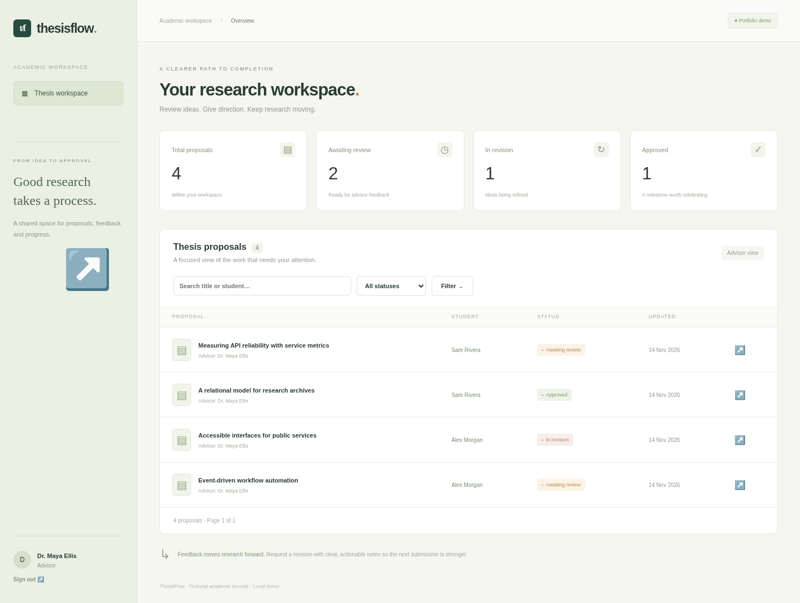

# ThesisFlow

[](https://github.com/KucukBoran/thesisflow/actions/workflows/ci.yml)

**A focused thesis proposal and review workflow.**

PHP 8.3+ · PDO · SQLite · Server-rendered HTML · CSS

ThesisFlow gives students and academic advisors a shared place to submit
proposals, attach PDFs, discuss revisions and record approvals. Authorization is
checked for each record, including document downloads.

The application uses PHP and SQLite with seeded sample accounts and fictional
academic records.

## Preview



*Captured from the running local application with fictional demo data.*

## What works

- Student, advisor and administrator accounts.
- Ownership-scoped lists, search, status filtering and pagination.
- Proposal creation and editing while a record is draft or in revision.
- Submission, revision requests with feedback and final approval.
- Comments and an activity trail.
- Private PDF uploads and authorized attachment downloads.
- Version checks to prevent stale changes from overwriting newer work.
- Session authentication, CSRF protection, login throttling and escaped output.
- Responsive server-rendered pages without a JavaScript build pipeline.

## Quick start

Install **PHP 8.3 or later** with `pdo_sqlite`, `mbstring` and `fileinfo` enabled.
PHP 8.4 was used for local verification. Check extensions with `php -m`.

```sh
php bin/seed.php
php -S 127.0.0.1:8080 -t public public/router.php
```

Open **http://127.0.0.1:8080**. The seed does not overwrite an existing database.
Run commands from the repository root. There are no third-party PHP runtime
packages, so Composer is optional; `composer.json` records requirements and
equivalent convenience commands.

| Role           | Email                   | Password       |
| -------------- | ----------------------- | -------------- |
| Student        | `student@example.test`  | `DemoPass123!` |
| Second student | `student2@example.test` | `DemoPass123!` |
| Advisor        | `advisor@example.test`  | `DemoPass123!` |
| Second advisor | `advisor2@example.test` | `DemoPass123!` |
| Administrator  | `admin@example.test`    | `DemoPass123!` |

All credentials and records are fictional demo data.

## Try the complete review cycle

1. Sign in as the student. Create a proposal and choose **Dr. Maya Ellis**.
2. Attach a small PDF, then submit the proposal.
3. Sign out and enter as `advisor@example.test`.
4. Open the proposal and request a revision with at least 10 characters of feedback.
5. Return as the student, edit and resubmit. Approve as the advisor.
6. Sign in as `student2@example.test`; the first student's private proposal and
   documents are inaccessible, even through a copied detail or download URL.

## Roles and rules

| Action                             | Student  | Assigned advisor | Admin |
| ---------------------------------- | -------- | ---------------- | ----- |
| Read proposal, comments, documents | Own only | Assigned only    | All   |
| Create proposal                    | Yes      | No               | No    |
| Edit draft/revision                | Own only | No               | Yes   |
| Upload PDF to draft/revision       | Own only | No               | Yes   |
| Submit draft/revision              | Own only | No               | No    |
| Review submitted proposal          | No       | Yes              | Yes   |
| Add comment                        | Own only | Assigned only    | All   |

Approved records are read-only, but participants can continue commenting.
There is no user-management screen, advisor reassignment or delete workflow.

## Tests

```sh
php tests/run.php
python3 tests/http_smoke.py
```

The second command uses only Python's standard library and starts its own PHP
server with an isolated temporary database, uploads and sessions. On Windows,
`python` or `py` may replace `python3`. Set `PHP_BINARY` if PHP is not on PATH.

The tests cover authorization, state changes, lost-update prevention, CSRF,
escaped text, file privacy and the actual HTTP upload/download flow.
The Actions workflow includes syntax checks and both test commands.

## Optional Docker demo

```sh
docker compose up --build
```

The app uses port **8080**, and a named volume preserves its database, documents
and sessions. This runs PHP's development server for a local demonstration, not
a production web server. See [testing](docs/VERIFICATION.md) for validation coverage.

## Configuration

Copy `.env.example` to `.env` if needed. Existing environment variables take
precedence. Relative paths resolve from the repository root.

| Variable         | Default                            |
| ---------------- | ---------------------------------- |
| `DB_PATH`        | `storage/thesisflow.sqlite`        |
| `UPLOAD_DIR`     | `storage/documents`                |
| `SESSION_PATH`   | `storage/sessions`                 |
| `SESSION_SECURE` | `false` — set to `true` with HTTPS |

The web root must stay **`public/`**. Database, sessions and uploaded PDFs are
stored outside it. Uploads use random storage names; downloads check record
access and force attachment disposition. Accepted files must be real HTTP
uploads with a PDF MIME type/header and a maximum size of 5 MiB. PHP's own
`upload_max_filesize` and `post_max_size` must allow the request; the Docker
configuration sets them to 5M and 6M.

## Project structure

| Path                    | Responsibility                                            |
| ----------------------- | --------------------------------------------------------- |
| `public/index.php`      | Front controller, HTTP forms and response handling        |
| `public/router.php`     | Local development routing                                 |
| `src/ThesisService.php` | Record access, workflow and transactional mutations       |
| `src/Auth.php`          | Password login, persistent throttling and CSRF validation |
| `src/Database.php`      | PDO connection and schema initialization                  |
| `database/schema.sql`   | Relational schema, constraints and indexes                |
| `views/`                | Escaped PHP templates                                     |
| `bin/seed.php`          | Fictional demo accounts and proposals                     |

- [Architecture](docs/ARCHITECTURE.md)
- [Testing](docs/VERIFICATION.md)

## Scope and next steps

This compact app intentionally uses plain PHP so the request lifecycle and access
rules are easy to inspect. It is not a full university information system.
Next steps include account provisioning, schema migrations, storage quotas,
document scanning, soft deletion and a production PHP-FPM deployment. PDF header
validation does not replace malware scanning. Data retention and institutional
identity integration are outside this demo.

References: [PHP password hashing](https://www.php.net/manual/en/function.password-hash.php),
[PDO](https://www.php.net/manual/en/book.pdo.php),
[PHP sessions](https://www.php.net/manual/en/book.session.php).

MIT licensed. See [LICENSE](LICENSE).
