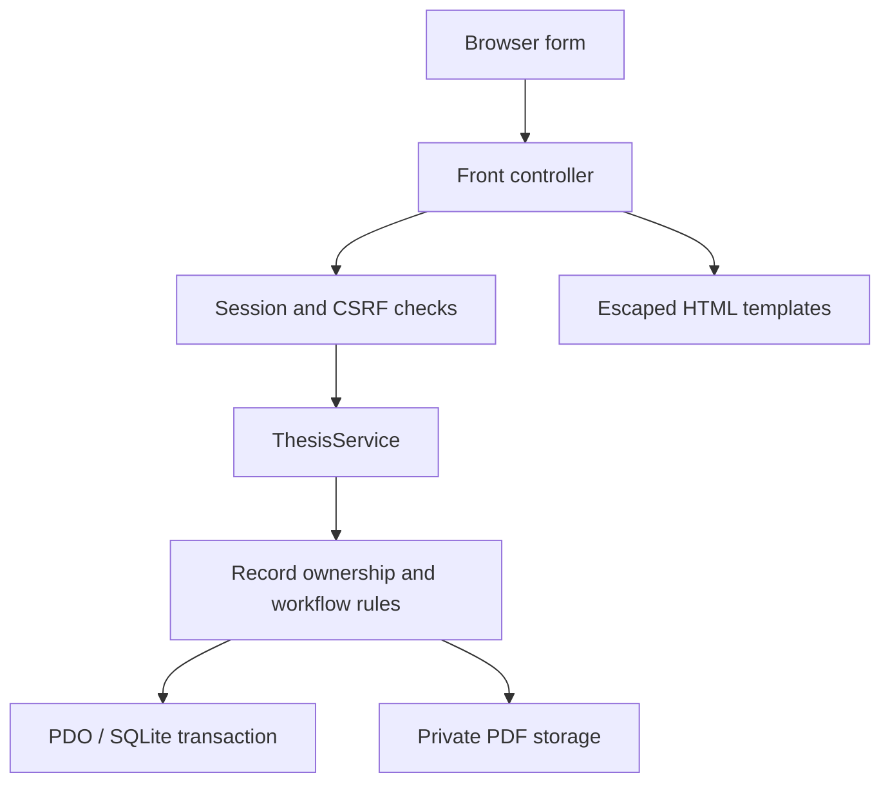
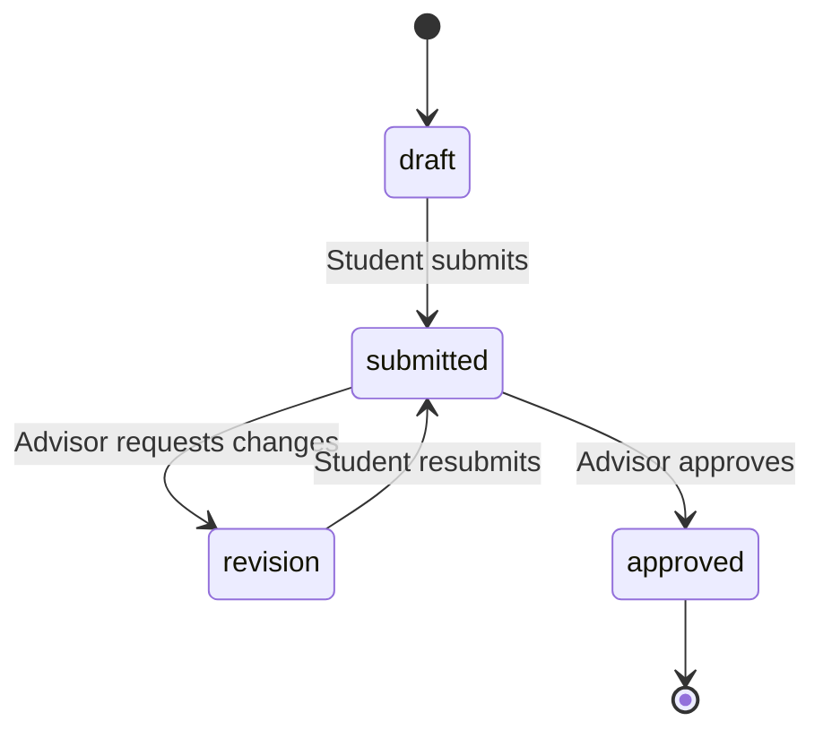
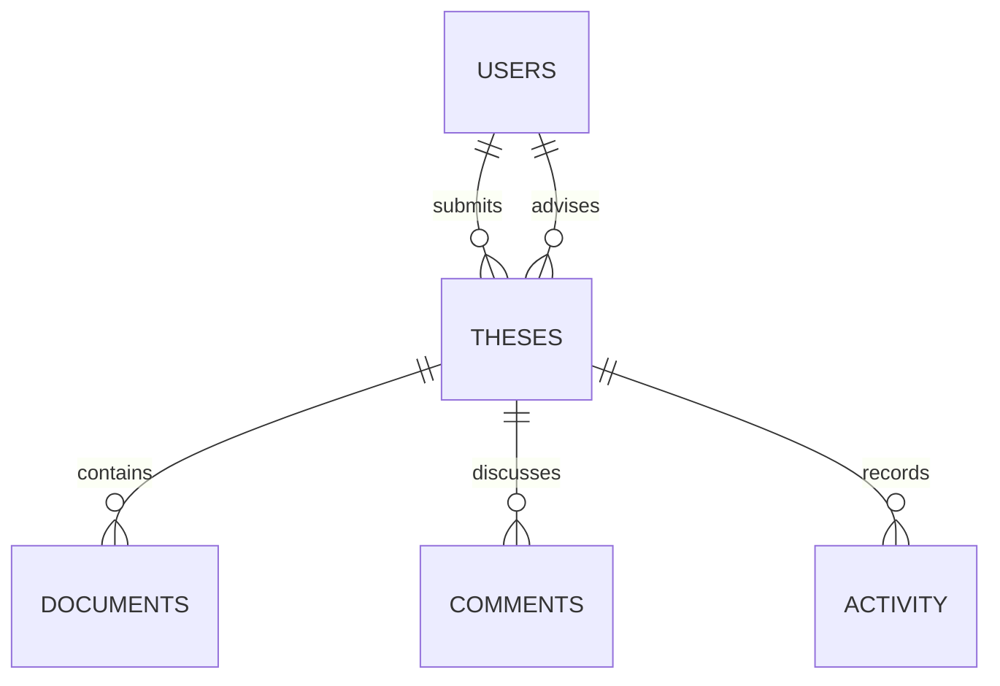

# Architecture

## Boundaries

The controller handles HTTP and delegates business rules to the service. Service
methods can be tested without a browser. There is no framework or ORM; prepared
PDO statements expose the underlying relational model.

## State machine

An admin can review all submitted records. A student cannot approve their own
proposal; an advisor cannot read another advisor's records merely by changing an
ID. Missing and inaccessible records both return 404.

## Relational model

`comments.author_id` and `activity.user_id` also reference users. The service
verifies user roles when assigning an advisor; the foreign key alone only checks
that the user exists.

## Transactions and conflicts

Write operations begin an immediate transaction to lock writers before checking
the current version. Forms carry a version number. Stale edits and reviews return
409; successful edits, transitions and uploads increment it. Reviews and their
feedback/history commit together.

PDF storage and SQL cannot share one atomic transaction. The app validates and
moves a file to a random name, then rechecks record state under the database lock.
If SQL fails, it removes the moved file. A process crash between moving and
committing can still leave an orphan; a future maintenance job should reconcile
unreferenced files. The download route never accepts a path from the caller.

## Security scope

Sessions use strict mode, regenerated IDs on login, HttpOnly/SameSite cookies,
an eight-hour app lifetime and a per-session CSRF token. Every dynamic template
value is escaped with `e()`. SQL values are bound. Login failures are persisted
by hashed client IP. Behind a proxy, configure trusted forwarding and rate limits
at the edge; the demo intentionally does not trust arbitrary forwarded headers.

The app does not scan PDFs for malicious content, manage real accounts, handle
multi-institution tenancy or automatically migrate old database versions.
